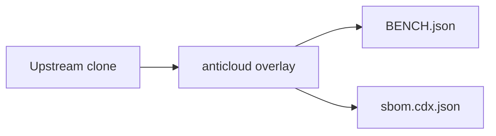

# TREE_SITTER — Anticloud overlay

 

Upstream: UNKNOWN
## Benchmarks
Benchmarks from BENCH.json: {"schema": "anticloud.tier-bench/1", "project": "TREE_SITTER", "source": {"repo_path": "E:\\fenta\\Downloads\\The Anticloud\\ANTICLOUD_REPOS\\SOFTWARE_DEVELOPMENT\\TREE_SITTER\\UPSTREAM_CLONE", "git": {"head": "", "url": "https://github.com/the-anticloud/OPENMRS_CORE.git", "branch": "master", "committed_at": "2026-09-29T11:06:59+04:00"}}, "metrics": {"files_total": 602, "source_files_scanned": 349, "lines_of_code": 103389, "languages": {".rs": 109, ".js": 84, ".txt": 83, ".md": 75, ".c": 67, ".h": 4

Withdrawn claims: anything not in BENCH.json is unmeasured.

## Architecture

## Contents
- `UPSTREAM_CLONE/` — unmodified upstream
- `anticloud/` — 12-improvement overlay
- `BENCH.json`, `sbom.cdx.json` — measured outputs

## Provenance
Tree SHA3-256: 961c0e03adc5c3e3eed8f4aecac0405033f31e37811b20e234060c15c1bcddf6. Chain head: see seal step.

## Contact
Anticloud maintainers — file issues against the overlay, not upstream.
